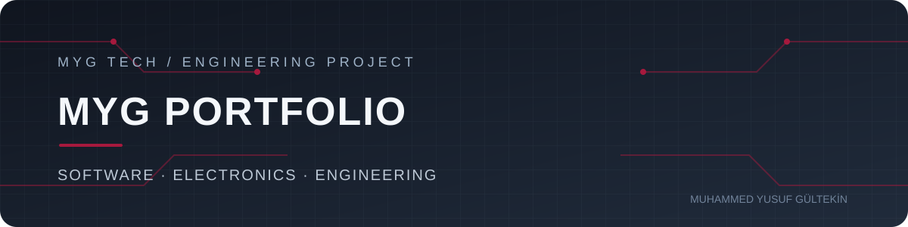

<div align="center">
  <a href="https://myusufgultekin.web.app/"></a>
  <p><a href="https://myusufgultekin.web.app/"></a>  </p>
  <p><a href="https://myusufgultekin.web.app/">MYG TECH</a> · <a href="https://github.com/nicewo">GitHub Profile</a></p>
</div>

---

# MYG — Muhammed Yusuf Gültekin

**Software & Electronics Engineer**

Personal portfolio website of Muhammed Yusuf Gültekin, presenting work across software development, embedded systems, electronics, and industrial automation.

🌐 **Live website:** [myusufgultekin.web.app](https://myusufgultekin.web.app)  
**Status:** Published on Firebase Hosting

## Brand identity

| Token | Color | Usage |
|---|---|---|
| Charcoal | `#17191E` | Primary background |
| Burgundy | `#A6193D` | Primary brand accent |
| Parliament Blue | `#234B75` | Technology accent |
| Metallic Grey | `#C2C6CC` | Main text and logo contrast |

The visual direction is technical, modern, and minimal, with a charcoal dark interface and burgundy / parliament-blue identity.

## Focus areas

- Software development: C#, C++, JavaScript, Node.js
- Embedded systems and microcontrollers
- Electronics and PCB design
- Industrial automation, PLC and SCADA
- Machine software and engineering tools
- 3D design and product development

## Selected projects

The portfolio highlights verified public repositories and summarizes private engineering work without exposing private repository URLs. Current highlights include:

- **VP100** — Integrated vision and PLC development platform
- **EVAS** — Industrial data monitoring and analysis system
- **MYG RideR** — GPS-based motorcycle tracking application

### Products (free downloads)

- **MYG Electrical** — free Windows IEC electrical schematic software ([source](https://github.com/nicewo/MYG.Electrical), [releases](https://github.com/nicewo/MYG.Electrical/releases)).
  The download button always points to `releases/latest/download/MYG.Electrical-win-Setup.exe`.
  The version badge is filled client-side from the GitHub Releases API (`releases/latest`, drafts/prereleases ignored),
  cached in `localStorage` for 6 h and retried no sooner than 30 min after an error / rate limit.
  Until the API answers, the cached or last-known version (`RELEASE_FALLBACK` in `assets/js/main.js`) is shown;
  update that constant occasionally. No backend is involved.

## Technology

The first release is intentionally built with plain web technologies:

- HTML5
- CSS3
- Vanilla JavaScript
- SVG assets

No frontend framework or backend is required for the initial static release. The project can evolve later with a content management system and an administration panel.

## Local development

This is a static website. You can open `index.html` directly in a browser or run a local development server, for example:

```bash
python -m http.server 5500
```

Then visit [http://localhost:5500](http://localhost:5500).

## Deployment

The site is deployed on Firebase Hosting at [myusufgultekin.web.app](https://myusufgultekin.web.app). A custom domain can be connected separately.

## Repository structure

```text
mygultekin-site/
├── index.html
├── 404.html
├── firebase.json
├── .firebaserc
├── .gitignore
├── README.md
└── assets/
    ├── css/
    │   └── style.css
    ├── js/
    │   └── main.js
    └── images/
        └── myg-logo.svg
```

## License

The source code is available under the MIT License. The MYG name and logo, personal identity, photographs, project names, written portfolio content, and other personal or brand materials are not granted for reuse by that license unless explicitly stated otherwise. See [LICENSE](LICENSE).

---

Built by **Muhammed Yusuf Gültekin**.

## Yayın (Firebase Hosting)

Site `https://myusufgultekin.web.app` adresinde yayınlanır (`firebase.json` → `"site": "myusufgultekin"`).

İlk kurulum (bir kez):

```bash
npm install -g firebase-tools
firebase login
firebase hosting:sites:create myusufgultekin   # proje: mygultekin-1ce3f (.firebaserc)
```

Firebase konsolunda:

1. **Authentication → Sign-in method → Google** sağlayıcısını aç.
2. **Authentication → Settings → Authorized domains** listesine `myusufgultekin.web.app` ekle.
3. **Firestore Database** oluştur (production mode, bölge: `europe-west3` gibi yakın bir bölge).

Yayına alma:

```bash
firebase deploy --only hosting,firestore:rules
```

## Uygulama olarak kurma (PWA)

`manifest.webmanifest` + `sw.js` ile site telefona kurulabilir:
Android Chrome → menü → **Uygulamayı yükle**, iPhone Safari → Paylaş → **Ana Ekrana Ekle**.
Kurulu uygulamalara değişikliği hemen ulaştırmak için `sw.js` içindeki `CACHE` sürümünü artır.

## Gizli panel

- Giriş: ana sayfada footer'daki **"DESIGNED & BUILT WITH PURPOSE."** yazısına 2 saniye içinde 5 kez dokun (veya doğrudan `/panel`).
- Google ile giriş yapılır; yetki `firestore.rules` ile sunucu tarafında kontrol edilir. Sayfanın gizli olması güvenlik değildir, asıl koruma kurallardır.
- İlk girişte panel hesabın **UID**'sini gösterir. Firebase konsolunda **Firestore → `admins`** koleksiyonuna belge kimliği bu UID olan boş bir belge ekle; sayfayı yenileyince panel açılır. Admin kaydı koddan yazılamaz.
- Panel yalnızca Firebase Hosting'de (veya `firebase emulators:start --project demo-myg`) çalışır; ayarları `/__/firebase/init.json` adresinden alır, repoda API anahtarı yoktur. Yerelde (`127.0.0.1:5000/panel`) otomatik olarak auth/firestore emülatörlerine bağlanır.
- Panel kart tabanlıdır: her kart bir uygulamaya kısayoldur (başlık, etiket, açıklama, `https://`/`http://`/`ssh://` adres, kopyalanacak komut). Kartlar panelden eklenir/düzenlenir, Firestore `apps` koleksiyonunda durur. Kartlara şifre veya anahtar yazılmaz; kurallar fazladan alanı ve `javascript:` gibi adresleri reddeder.

## vp100dev web terminali

`ops/vp100dev-web-ssh.sh` vp100dev üzerinde `ttyd` (tarayıcı terminali, tmux oturumu) ve
`tailscale serve` kurar. Yalnızca Tailscale ağındaki cihazlardan açılır, internete açık değildir:
terminal `https://vp100dev.<tailnet>.ts.net`, VP100 PLC arayüzü `https://vp100dev.<tailnet>.ts.net:8443`
(runtime `127.0.0.1:8080`, farklıysa `VP_PORT=<port>`). Çıkan adres paneldeki karta yazılır. `ops/` klasörü yayına çıkmaz.
